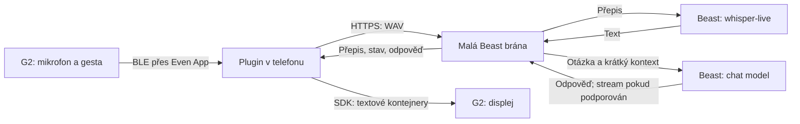

# Beast pro Even G2 — analýza a návrh

Datum: 25. října 2026. Stav: návrh, bez implementace a bez živých volání Beast API.

## Rozhodnutí

Vlastní Even Hub plugin je proveditelný s veřejným SDK. Mikrofon G2 poskytne PCM, Whisper na Beastu přepis a textový model na Beastu odpověď. Doporučený první produkt: uživatel spustí záznam, položí otázku a přečte odpověď na brýlích; průběžný poslech přidat po ověření základní cesty.

Klient zůstane malý: TypeScript + Vite + Even SDK. Pro běžné používání doporučuji malou HTTPS bránu před Beastem; přímé spojení z telefonu je jednodušší alternativa, pokud projde CORS, síťová dostupnost a způsob zadávání klíče. Brána není Hermes a nepotřebuje agentní framework.

## Ověřené podklady

- Lokálně instalované SDK `0.0.16`, jeho README a TypeScript deklarace. Balíček uvádí minimální Even App `2.2.10`. Nejde o nové ověření aktuálního npm tagu latest.
- Stávající projekt obsahuje základ displeje, ovládání, simulátor a balení `.ehpk`; podle předchozího záznamu prošel simulátorem. V tomto analytickém kroku nebyl znovu spuštěn.
- Místní Hermes config: chat `beast/big`, alias pro `beast/small`, základ `https://beast.example.com`; STT provider `openai`, model `whisper-live`, základ `https://beast.example.com/v1`.
- Hermes STT má globálně `language: en`; nový klient bude mít vlastní volbu `cs`, `en` a automaticky. Prázdná providerová hodnota v Hermesu sama o sobě nepotvrzuje automatickou detekci, pokud může převzít globální jazyk.
- Lokální názvy nepotvrzují aktuální dostupnost API ani přesný protokol. Přípona `live` nedokazuje podporu streamovaného přepisu.

Žádné tajné hodnoty z konfigurace nejsou v tomto dokumentu.

## Co poskytuje platforma

### Mikrofon

Dokumentace popisuje jednu mono stopu: PCM 16 kHz, signed 16-bit little-endian. Čtyřmikrofonové pole neposkytuje čtyři nezávislé kanály. Pro G2 je potřeba nejprve vytvořit úvodní stránku a poté volat `audioControl(true, AudioInputSource.Glasses)`; data přicházejí v `event.audioEvent.audioPcm`. Přístup vyžaduje oprávnění `g2-microphone`.

Lokální SDK navíc poskytuje `source`, `direction` a `speakerRole`. Poslední dvě pole nebudou podmínkou funkčnosti: role je klasifikace algoritmu aplikace, není zárukou identity mluvčího.

Zdroj: [Device APIs](https://hub.evenrealities.com/docs/build/device-apis), lokálně `node_modules/@evenrealities/even_hub_sdk/README.md` a `dist/index.d.ts`.

### Běh aplikace a síť

Plugin běží ve WebView Even aplikace na telefonu. G2 slouží jako mikrofon, displej a vstup; modely nepoběží na brýlích. HTTP a WebSocket komunikace běží z telefonu. Cíl musí být v manifestovém network whitelistu a HTTP API musí zvládnout CORS včetně preflightu. Whitelist CORS neobchází. Dokumentace požaduje úplné origins bez wildcardů; pro produkci HTTPS.

Zdroje: [Overview](https://hub.evenrealities.com/docs/get-started/overview), [Networking](https://hub.evenrealities.com/docs/build/networking).

### Displej a ovládání

Displej má 576 × 288 bodů; používá nativní textové, obrazové a seznamové kontejnery. Pro tuto aplikaci stačí stavový text a odpověď. `textContainerUpgrade` aktualizuje text bez celé přestavby stránky; `rebuildPageContainer` používat při změně rozložení.

SDK podporuje tap, double tap, swipe a od verze `0.0.14` také začátek a konec dlouhého stisku. OS může některé kombinace převzít pro menu. Ovládání hlasu proto nesmí záviset pouze na dlouhém stisku.

Zdroje: [Display](https://hub.evenrealities.com/docs/build/display), [Page Lifecycle](https://hub.evenrealities.com/docs/build/page-lifecycle), [Device APIs](https://hub.evenrealities.com/docs/build/device-apis).

### Pozadí: dokumentace si částečně odporuje

Stránka Background & Lifecycle uvádí zachování běhu na iOS a možné uspání Android WebView. Novější FAQ uvádí obecné pozastavení síťových operací na pozadí. Private Testing navíc popisuje omezené přežití zamčení a doporučuje beta instalaci pro test pěti minut se zamčeným telefonem.

Z toho nelze slíbit nepřetržitý poslech se zamčeným telefonem. Návrh musí přežít ztrátu procesu, přerušení audia a nedoručenou odpověď. Server neobnoví mikrofon pozastaveného WebView.

Zdroje: [Background & Lifecycle](https://hub.evenrealities.com/docs/build/background-lifecycle), [FAQ](https://hub.evenrealities.com/docs/reference/faq), [Private Testing](https://hub.evenrealities.com/docs/test/private-testing).

## Navržená architektura

Modely i konkrétní API cesty jsou konfigurací brány. Klient zná jediný origin a párovací token pro vlastní bránu. Brána drží Beast klíč v serverovém prostředí; nesmí ho posílat do klienta ani logů. Pro osobní nasazení preferovat existující dostupný host poblíž Beastu. Mac může sloužit při vývoji; pro každodenní použití by pak musel zůstat zapnutý a dostupný telefonu.

### Přímé spojení versus brána

| Varianta | Přínos | Podmínky / náklady |
|---|---|---|
| Telefon → Beast | Nejméně částí, bez dalšího provozu | Beast dostupný z telefonu, funkční CORS, uživatelské zadání klíče za běhu; úložiště pluginu není doložený trezor |
| Telefon → brána → Beast | Klíč mimo balíček, jednotné chyby a protokol, serverová diagnostika | Další host, autentizace, HTTPS a jeho dostupnost; mírná síťová režie |

Rozhodnutí uzavřít krátkou technickou zkouškou. Bránu lze vynechat, pokud přímá cesta splní podmínky a je přijatelná pro osobní použití. Klíč nesmí být v `.ehpk`, ani ve frontendových proměnných `VITE_*`.

Zdroje pro omezení přímé cesty: [Networking](https://hub.evenrealities.com/docs/build/networking), [Packaging](https://hub.evenrealities.com/docs/ship/packaging).

## Zpracování jednoho dotazu

1. Připojit bridge, zaregistrovat jediný odběr událostí, vytvořit stránku a ověřit výsledek.
2. Tap spustí mikrofon; stav „Poslouchám“ zobrazit po úspěšném zapnutí. Čas do prvního PCM měřit.
3. Uchovávat PCM v omezeném bufferu. Druhý tap ukončí záznam; automatické ukončení po tichu lze přidat s nastavitelným prahem. Limit jednoho záznamu navrhuji 30 s.
4. Zabalit do WAV s 44bajtovou hlavičkou. Při dokumentovaném formátu jde o 32 000 B/s; 10 s = asi 320 kB, 30 s = asi 960 kB plus hlavička.
5. Odeslat na přepis. Pokud Beast nabízí kompatibilní multipart rozhraní, použít model `whisper-live` a soubor WAV. Před implementací ověřit cestu, pole, jazyky a formát odpovědi.
6. Prázdný přepis neodesílat chat modelu. Zobrazit přepis a poslat otázku s omezeným kontextem na Beast.
7. Při podporovaném streamování průběžně skládat odpověď; na displej ji posílat sloučeně přibližně po 250–500 ms, maximálně jedním SDK zápisem současně. Jde o počáteční nastavení k měření, nikoli limit SDK.
8. Uživatel může dotaz zrušit; pozdní odpověď předchozího dotazu nesmí přepsat novou.

Pro první verzi postačí konečný WAV a REST. WebSocket a průběžné přepisy řešit teprve tehdy, když je Beast skutečně podporuje a měření ukáže přínos.

## Uživatelské chování

Stavy: Připraveno → Poslouchám → Přepisuji → Odpovídám → Odpověď; samostatně Přerušeno a Chyba. Zpracování audia musí být nezávislé na vykreslování.

- Tap v klidu: začít otázku. Tap během nahrávání: ukončit a odeslat.
- Swipe: číst delší odpověď po stránkách. Automatické přepisování právě čtené starší stránky vypnout.
- Menu: Nová otázka, Zrušit, Vymazat kontext; nastavení a test spojení na telefonu.
- Dlouhý stisk: volitelný režim držím a mluvím po ověření chování na G2; zachovat cestu přes tap/menu.
- Ukončení z kořenové obrazovky přes systémový dialog `shutDownPageContainer(1)`.

Na brýlích krátká odpověď v několika větách; na telefonu celý přepis a odpověď. U češtiny otestovat diakritiku skutečného fontu. Podporované kódy jazyka manifestu nyní nezahrnují `cs`; jazyk rozpoznávání a generované odpovědi je samostatná věc. Pro první balíček zvolit podporované UI locale, např. `en`.

Zdroje: [Page Lifecycle](https://hub.evenrealities.com/docs/build/page-lifecycle), [Packaging](https://hub.evenrealities.com/docs/ship/packaging), [Display](https://hub.evenrealities.com/docs/build/display).

## Plynulost a chyby

- Jediný aktivní hlasový dotaz. Zrušení ukončí klientské čekání; nemusí zastavit inference na Beastu, pokud API neumí serverové zrušení.
- Neprovádět render ani síťový požadavek na každý PCM rámec. Neslučovat opakovaně stále rostoucí buffery.
- Fronta displeje drží nejnovější požadovaný text, nikoli všechny mezistavy. Beze změny text neposílat.
- Žádné celé překreslení pro každý token. Audio callback dělá minimum práce.
- Při resume ověřit spojení, vyčistit nedokončený PCM buffer a označit přerušený záznam. Mikrofón znovu spustit podle explicitního aktivního režimu, bez falešného indikátoru poslechu.
- Časové limity oddělit pro přepis, první token a celou odpověď; doladit podle měření. Po ztrátě sítě automaticky neodesílat staré audio opakovaně.
- Uchovávat jen omezený počet textových tahů. Audio po přepisu uvolnit; do trvalého úložiště výchozím nastavením neukládat audio ani konverzaci.
- Diagnostika: fáze STT/chat, HTTP status, zvolený model, bezpečně očištěná chyba serveru a request ID. Bez klíčů a bez výchozího logování audio obsahu.

Tato opatření jsou návrh pro naši aplikaci. Příčina sekání Aside nebyla změřena a nelze ji z nich odvozovat.

## Co ověřit na Beastu jako první

| Otázka | Ověření a výsledek potřebný pro pokračování |
|---|---|
| Chat protokol a model | Zjistit přesný endpoint a dostupná ID; jeden minimální dotaz bez streamu, pak samostatně se streamem |
| Whisper protokol | Krátký známý český WAV → `whisper-live`; potvrdit multipart/REST nebo zdokumentovaný jiný protokol |
| Jazyk | Ověřit podporu explicitního `cs` a detekce; nemít skrytý anglický default |
| Dostupnost z telefonu | Vyzkoušet skutečnou Wi-Fi i mobilní data; zjistit požadavek VPN či firemní sítě |
| CORS | Prověřit preflight a skutečný požadavek z Even WebView; úspěšný serverový curl nestačí |
| Latence | Změřit přepis, první token, dokončení; porovnat `beast/small` a `beast/big` na stejných úlohách |

Možné cesty `/v1/models`, `/v1/audio/transcriptions` a `/v1/chat/completions` jsou kandidáti kompatibilního API, ne potvrzené Beast endpointy. HTTP 400 z Aside zatím nedokazuje, který server, model nebo konkrétní část požadavku byla chybná.

## Ověřovací plán a etapy

1. **Technická zkouška, orientačně půl až jeden den:** Beast chat + známý WAV, první reálný PCM z G2, síťová cesta z telefonu. Výstup: potvrzené API a změřené úzké místo. Toto je rozhodovací bod architektury.
2. **MVP, další 1–3 vývojové dny:** hlasová otázka, Whisper, krátká odpověď, stránkování, zrušení, jednoduché nastavení a viditelné chyby. Odhad předpokládá funkční API i mikrofon.
3. **Použitelná beta, další 2–5 dnů:** resume, reconnect, zamčený telefon, odpojení BLE, opakované dotazy, baterie a ladění latence. Doba závisí na dostupnosti skutečných brýlí a telefonu.
4. **Průběžný poslech:** až po betě; detekce řeči, krátký pre-roll, segmentace, deduplikace přepisu a rozhodování, které otázky zodpovědět. Whisper bez doloženého streaming API bude pracovat po úsecích a nelze slíbit okamžitý průběžný přepis.

Cíl MVP je první text na brýlích přibližně do 2–5 s po dokončení otázky, nikoli slíbené měření. Reportovat alespoň p50/p95 na sadě krátkých českých a anglických otázek. Pokud součet nahrání, STT a první odpovědi tento rozpočet překročí, optimalizovat změřenou fázi.

Testy: WAV hlavička a pořadí PCM, stavový automat a pozdní odpovědi, limity bufferu, fragmentovaný stream, obnova po chybě. Simulátor pro gesta a displej; skutečné G2 pro audio, oprávnění, BLE, české znaky a baterii. Beta na konkrétním telefonu pro 5minutový lock test a delší 30–60minutovou relaci. Žádné z těchto nových měření zatím neproběhlo.

## Even Hub a instalace

Použít nový package ID pro Beast aplikaci a ponechat současné demo oddělené. Deklarovat `g2-microphone` a `network` pouze pro skutečně používaný origin. Lokální QR je nejrychlejší vývojová cesta, ale není důkazem produkčního síťového chování.

Soukromý `.ehpk` lze instalovat z telefonu bez veřejného vydání. Pro spuštění přímo z menu brýlí a relevantní test zamčeného telefonu použít beta kanál a aktivní členství testera. Veřejný store zatím není potřeba. Instalace v telefonu je manuální.

Lokální CLI `0.1.14` podle předchozího ověření nepodporovalo všechny novější příkazy z online dokumentace. Při realizaci ověřit skutečný `--help`; chybějící správu buildů provést portálem, případně samostatně zhodnotit aktualizaci CLI.

Zdroje: [Private Testing](https://hub.evenrealities.com/docs/test/private-testing), [Beta Testing](https://hub.evenrealities.com/docs/test/beta-testing), [CLI](https://hub.evenrealities.com/docs/cli), [Packaging](https://hub.evenrealities.com/docs/ship/packaging).
